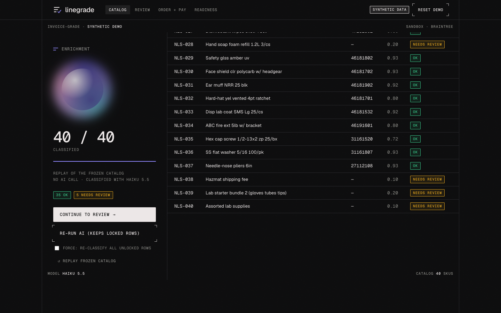
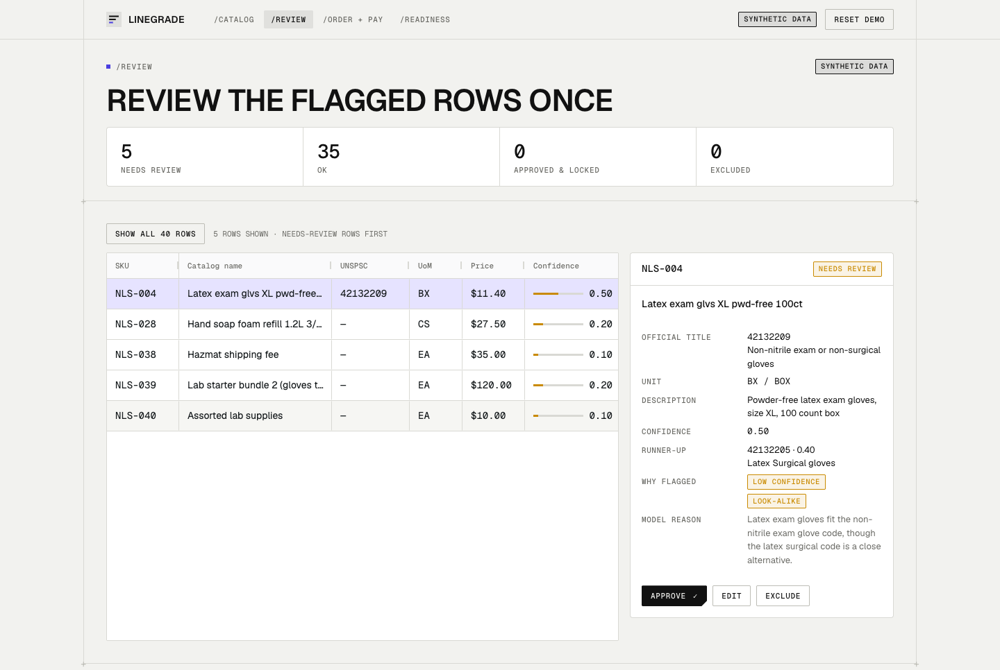
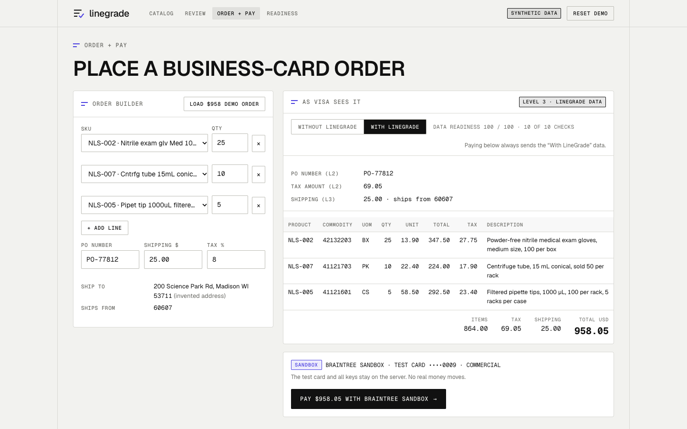
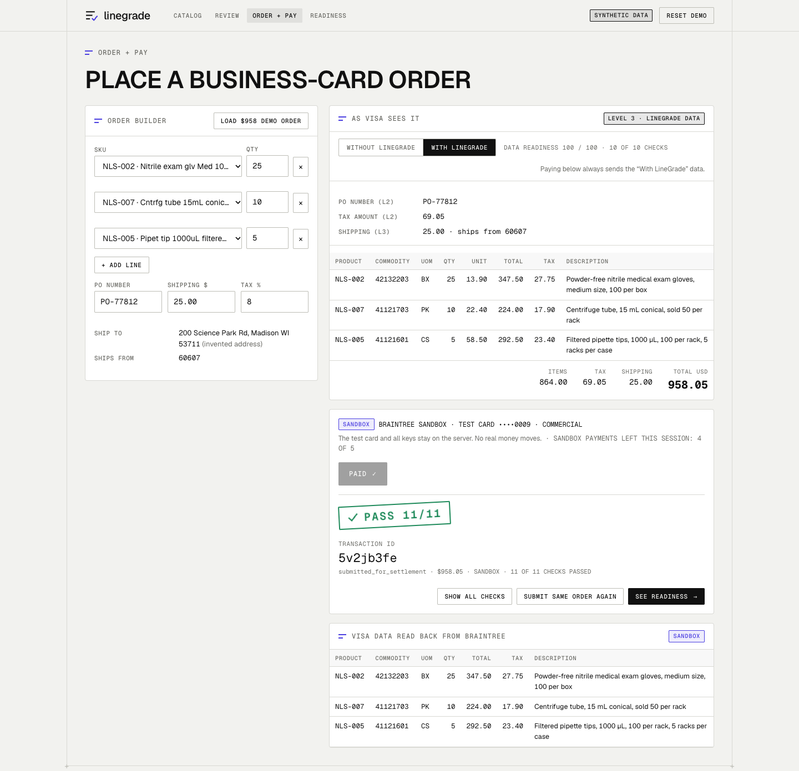
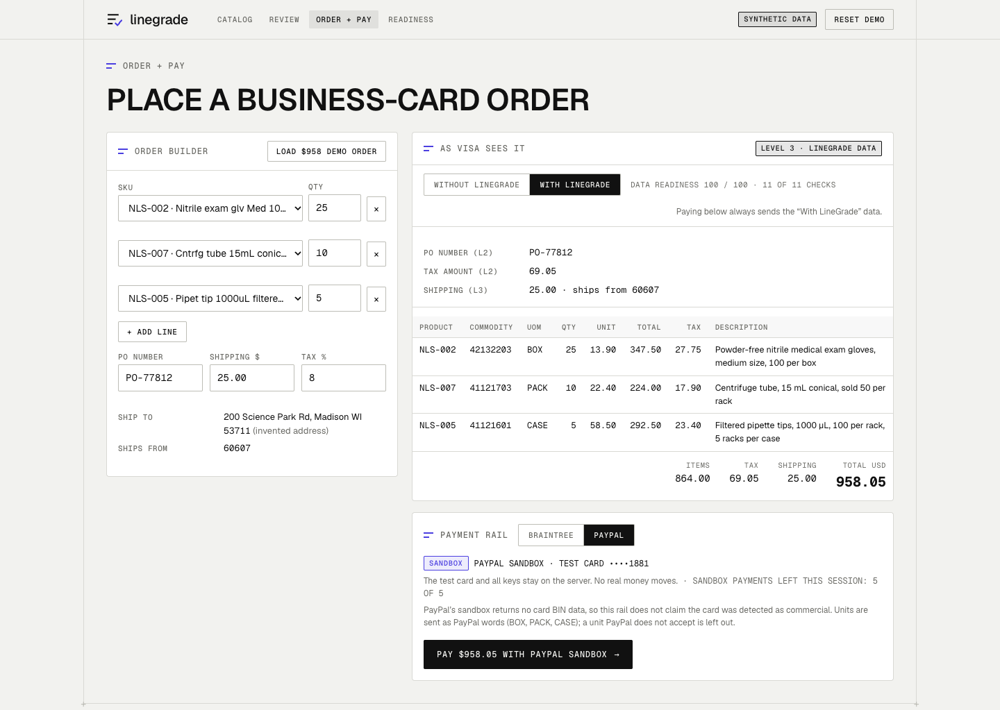
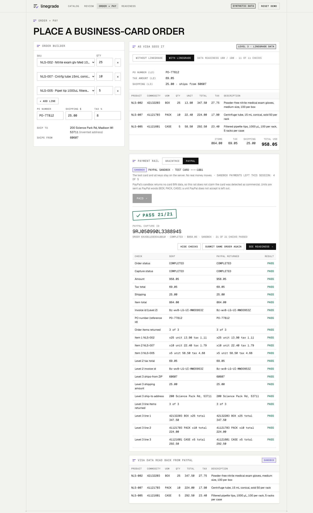
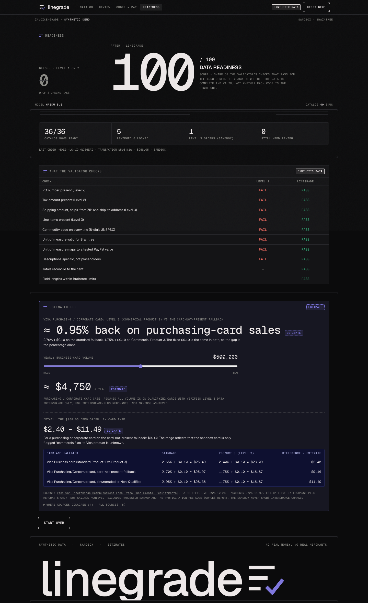

# LineGrade

**Invoice-grade card data for B2B sellers.**

LineGrade turns a seller's messy catalog into the line-item data that business-card payments need, and sends every order with that data through **Braintree** or **PayPal Orders v2** (sandbox). All catalog data is **synthetic**, and any fee figure is an **estimate**.

- **Live demo:** https://linegrade.onrender.com (free server: it sleeps when idle and can take from a few seconds up to about a minute to wake; the page waits for it by itself)
- **Licence:** MIT, see `LICENSE`. The UNSPSC code list is © UNDP, is **not included** and is not covered by MIT: see `NOTICE`.

## The problem

Visa has removed its Level 2 incentives, so verified Level 3 line-item data is now the main route to lower interchange on B2B card payments ([PYMNTS](https://www.pymnts.com/news/b2b-payments/2026/its-level-3-or-bust-as-visas-interchange-shift-rewires-b2b-data/)) (Visa's Commercial Enhanced Data Program is built around it). Visa rejects placeholder values such as "ITEM1" on every line ([Pagos](https://pagos.ai/learn/cost)), and reports describe merchants reclassified as non-verified after audits found placeholder or auto-filled data ([Crowdfund Insider](https://www.crowdfundinsider.com/2026/03/264411-verisave-fee-navigator-optimized-payments-create-compliance-tool-for-visas-cedp/)). Most small B2B sellers send none of it, because simple gateways and invoicing tools only capture Level 1 ([Beancount](https://beancount.io/blog/2026/10/12/interchange-downgrades-level-3-data-b2b-processing-costs-guide)), and Braintree and Stripe need custom development to pass line items ([EBizCharge](https://ebizcharge.com/?p=83178)).

Sources are secondary (trade press and vendor blogs) and disagree on details, for example whether standard small-business cards benefit, and Visa's verification program status has been in flux. The demo uses a purchasing/corporate card case. See `EVIDENCE.md`.

## What it does

1. **Catalog in:** a messy product list (`"Nitrile exam glv Med 100/bx pf"`, price).
2. **AI classification:** each line gets an 8-digit UNSPSC commodity code, a unit of measure and a specific description. A shortlist from the code list narrows the choices and an LLM picks among them.
3. **Review flagged rows:** low-confidence, no-code or look-alike rows stop for a person to approve, edit or exclude (fees, bundles and vague lines are excluded, never coded).
4. **Every order carries Level 3:** the order builder turns SKUs and quantities into PO number, tax, shipping, ships-from ZIP and line items with commodity code, unit and description, checks them (totals to the cent, no placeholder descriptions, field limits), and pays through the **Braintree** or **PayPal Orders v2** sandbox. After payment the order is read back from the processor and compared with what was sent.

## Try it (about 3 minutes)

The deployed demo **replays a saved AI run** (see "Honest labels"), so nothing below calls an LLM.

1. Open https://linegrade.onrender.com and click **Load demo catalog**. The 40-line synthetic catalog streams in, labelled **REPLAY**.
2. Click **Continue to review**. It opens on the 5 flagged rows ("5 needs review"). Approve or exclude each one (fee and bundle lines should be excluded).
3. Go to **Order + pay** and click **Load $958 demo order**. Flip **Without LineGrade / With LineGrade** to see what the card network receives with and without the data.
4. Pick a **Payment rail** (Braintree or PayPal), then **Pay $958.05 with … sandbox**. A sandbox payment is made and read back; the stamp shows how many checks passed. Submit the same order again to see the duplicate guard.
5. Open **Readiness** for the before/after data scores and the fee **estimate** (change the yearly-volume slider).

Each browser gets its own session, so other visitors never see your changes. Sessions expire after 2 hours idle.

## Screenshots

All screens show synthetic data.

| | |
|---|---|
|  |  |
| Saved AI run replayed (REPLAY) | Flagged rows waiting for a person |
|  |  |
| What the card network receives | Braintree sandbox sale, read back |
|  |  |
| PayPal Orders v2 rail | PayPal sandbox capture, read back |
|  | |
| Before/after readiness and fee estimate | |

## How it is built

- **Server:** Node 22, Express 5. Per-browser sessions (cookie), per-session and daily caps, rate limits, a payment ledger (one entry per order id, so a retry cannot charge twice), `/health`.
- **UI:** React 19, Vite, AG Grid Community.
- **Payments:** Braintree Node SDK (`transaction.sale` with Level 2/3 fields, read back with `transaction.find` and line items). PayPal Orders v2 over REST (`supplementary_data.card.level_2` and `level_3`), with `PayPal-Request-Id` idempotency keys derived from our order id.
- **AI:** Claude Haiku 5.5 via OpenRouter, temperature 0. A keyword shortlist of the code list goes to the model; the chosen code must exist in the list, and the unit and description are validated before use.
- **Hosting:** one Render free web service; the API serves the built UI.
- **PayPal units:** PayPal's sandbox returned a 500 on some valid-looking `unit_of_measure` values (reported publicly to PayPal). The PayPal rail therefore sends only values that passed our tests (`KGM, LTR, ITM, ACR, EACH, BOX, PACK, CASE, POUND, KILOGRAM, LITER, UNIT`), maps short codes (`EA`→`EACH`, `BX`→`BOX`, `PK`→`PACK`, `CS`→`CASE`), and leaves a unit out, with the reason recorded, if it is still not on the list.
- **Accuracy method:** the classifier was **frozen** at a recorded commit and run **once** on a holdout written beforehand (`eval/holdout/`). The labels were checked by a person before the run.

## Accuracy

On a frozen holdout of 30 synthetic catalog lines, LineGrade chose an accepted 8-digit commodity code for 21 of 24 products, placed all 24 products in the right product class, and correctly declined to code the 6 vague or service lines.

This is a small sample and one model run. Every miss and every flagged row is listed in `eval/holdout/report.md`, which also records a label review done after the run.

## Fee estimate

Visa's published U.S. interchange schedule (effective 24 Oct 2026, read 7 Nov 2026): for Purchasing/Corporate cards, Commercial Product 3 is **1.75% + $0.10** versus Card Not Present **2.70% + $0.10**, a difference of about **0.95 percentage points**. That is shown as an **estimate** of the interchange rate difference for orders that carry verified Level 3 data. It assumes qualifying cards and verified data, covers interchange only (not processor markup, assessments or any participation fee), and is **not savings achieved**: the sandboxes never show interchange charged. Rates move, so the sources and dates are in `data/rates.json`.

## Honest labels

- **Sandbox only.** Braintree and PayPal sandboxes, test cards, no real money. Credentials stay on the server.
- **Synthetic data.** The catalog is an invented company ("Northfield Lab Supply"); the holdout lines are invented too.
- **Estimates.** Fee figures are estimates from a sourced rate table, never achieved savings.
- **The deployed demo replays a saved AI run.** The UNSPSC code list is licensed by UNDP and is not in this repository, so the hosted server cannot classify live; "Re-run AI" is disabled there. Live AI runs locally with the list you download yourself (below). The saved run records the code and title the classifier returned for each line; those titles remain UNDP's (see `NOTICE`).
- **PayPal card details.** PayPal's sandbox returns no card BIN data, so the PayPal rail makes no claim that the card is commercial. On Braintree the read-back checks the commercial flag as Braintree reports it.

## Run locally

```bash
cp .env.example .env          # Braintree sandbox keys; PayPal sandbox keys are optional; the LLM key is only for live AI
npm install && npm run web:install
npm run demo                  # builds the UI and serves it with the API on http://127.0.0.1:8787
npm run test:unit             # unit and API tests (no real payment calls)
npm run screens               # optional: clicks through the demo in Chrome and makes one sandbox sale (two if PayPal keys are set)
```

Without the UNSPSC list the app replays the saved run, exactly like the hosted demo. To run live AI locally:

1. Download the UNSPSC English workbook from https://www.unspsc.org (UNDP's terms apply) and save it as `data/unspsc_english.xlsx`.
2. `node scripts/build-subset.js` writes `data/unspsc-subset.csv` (both files are gitignored). `/health` then reports `codeList: "full"`.
3. Put `LLM_API_KEY` in `.env` and restart. "Re-run AI" is enabled, capped per session and per day (see `docs/OPERATIONS.md`).

The PayPal rail appears only when `PP_CLIENT_ID` and `PP_CLIENT_SECRET` are set (`PAYPAL_RAIL=off` hides it). Deploying and operating the hosted demo: `docs/OPERATIONS.md`.

## Repository notes

- `src/`: classifier, catalog enrichment, order builder (`enrich-sale.js`), validator, Braintree and PayPal payment code, fee estimate.
- `server/`, `web/`: API and UI. `data/`: synthetic catalog, saved AI run, rate table. `eval/`: evaluation harness and the frozen holdout.
- `braintree-l3-test.js`, `paypal-l3-test.js`: the early dependency tests (`npm run test:braintree`, `npm run test:paypal`) that checked both sandboxes accept Level 2/3 fields before anything was built.

## Licence

MIT, © 2026 AjKadri (`LICENSE`). Third-party notice for UNSPSC (© UNDP, not included): `NOTICE`.
